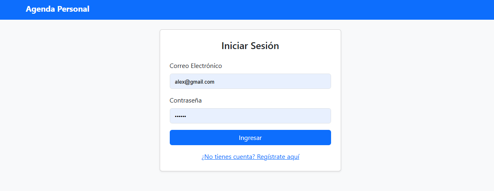
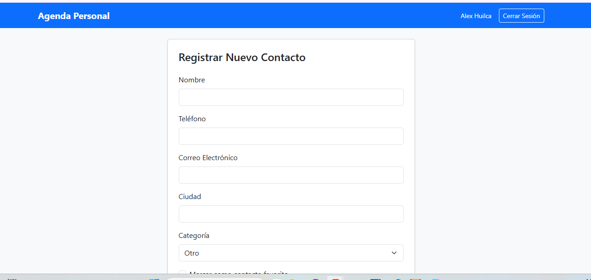
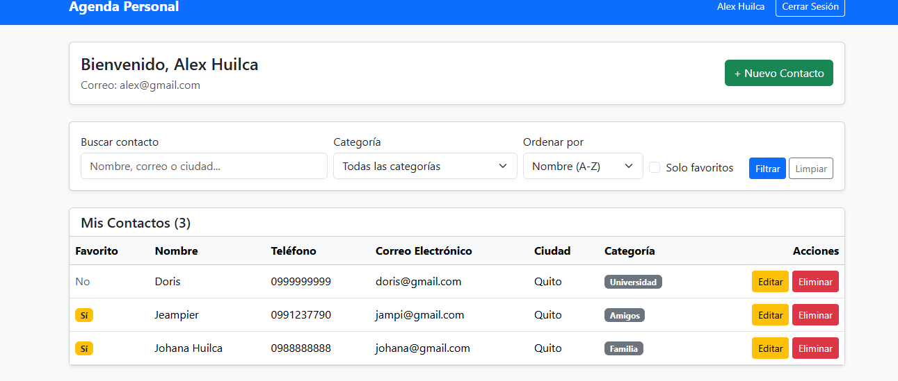

# Agenda Personal de Contactos

Aplicación web creada en PHP y MySQL que permite a cada usuario registrarse, iniciar sesión y administrar su propia lista de contactos de manera privada y organizada.

## Enlace de la aplicación en línea
* **URL pública:** http://agenda-alex.rf.gd

## Mejoras implementadas en esta versión
* **Búsqueda de contactos:** Filtrado por nombre, correo o ciudad.
* **Ordenamiento:** Organización de contactos por nombre, ciudad o fecha de creación.
* **Categorías:** Clasificación por Familia, Amigos, Trabajo, Universidad y Otro.
* **Contactos favoritos:** Marcado de favoritos y vista filtrada de destacados.

## Capturas de pantalla
* **Inicio de sesión:**
  

* **Registro de contacto:**
  

* **Panel de contactos creados:**
  

## Tecnologías utilizadas
* **Lenguaje:** PHP 8
* **Base de datos:** MySQL (PDO)
* **Diseño e interfaz:** HTML5 y Bootstrap 5
* **Hosting gratuito:** InfinityFree
* **Entorno local:** XAMPP (Apache)

## Cómo instalar y probar el proyecto localmente
1. Duplica o descarga esta carpeta dentro de `htdocs` en XAMPP (`htdocs/agenda-contactos`).
2. Enciende **Apache** y **MySQL** en el panel de XAMPP.
3. Importa el archivo `database.sql` en **phpMyAdmin** o **MySQL Workbench** para crear la base de datos y las tablas.
4. Verifica las credenciales locales en `config/db.php` (`localhost`, usuario `root`).
5. Entra en tu navegador a `http://localhost/agenda-contactos/`.